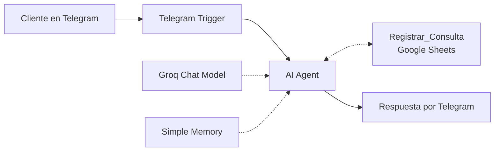

# Agente de atención y registro de consultas — Distribuidora Petriella

Agente de IA que atiende consultas de clientes por Telegram, solicita los datos que faltan y registra cada consulta en Google Sheets con prioridad, próxima acción y resumen.

Construido con n8n, Groq y Google Sheets.

> **Estado:** primera versión funcional (MVP). El diseño está pensado para escalar; ver el [roadmap](#roadmap).

## El problema

Las consultas llegan por chat como mensajes sueltos: cada persona escribe distinto, mezcla datos en una sola línea y no siempre informa todo lo necesario. Sin un registro estructurado:

- Los datos de contacto y los pedidos quedan dispersos en la conversación.
- No se sabe qué consultas son grandes o urgentes.
- No hay forma de medir cuántas consultas entran ni qué productos se piden más.

## La solución

Un agente conversacional que:

1. Recibe el mensaje del cliente por Telegram.
2. Detecta qué datos ya proporcionó y solicita, en un solo mensaje, los que faltan.
3. Clasifica la prioridad según la cantidad pedida.
4. Define la próxima acción para el equipo.
5. Guarda toda la información en una planilla de Google Sheets.
6. Confirma al cliente que su consulta quedó registrada.

El cliente recibe una respuesta inmediata y el equipo trabaja con una planilla organizada, lista para filtrar y analizar.

## Arquitectura



| Nodo | Función | Configuración clave |
|---|---|---|
| Telegram Trigger | Recibe cada mensaje entrante | Evento `message` |
| AI Agent | Interpreta el mensaje y decide cuándo pedir datos y cuándo registrar | Tools Agent, máximo de 6 iteraciones |
| Groq Chat Model | Modelo de lenguaje | `openai/gpt-oss-120b` |
| Simple Memory | Recuerda la conversación de cada chat | Ventana de 10 mensajes, clave de sesión = ID del chat |
| Registrar_Consulta | Escribe en Google Sheets | `Append or Update Row`, coincidencia por `Session_ID` |
| Send a text message | Responde al cliente | Envía al chat de origen, sin atribución de n8n |

El agente decide cuándo utilizar la herramienta a partir de su descripción, que contiene los datos mínimos requeridos, las reglas de prioridad y las acciones posibles. La herramienta se ejecuta una sola vez por consulta.

## Datos que se registran

| Columna | Contenido |
|---|---|
| `Session_ID` | ID del chat de Telegram. Lo completa el sistema, no el modelo. |
| `Nombre` | Nombre del cliente. |
| `Mail` | Correo electrónico o `No informado`. |
| `Telefono` | Teléfono o `No informado`. |
| `Producto` | Producto principal de la consulta. |
| `Cantidad` | Cantidad con su unidad, por ejemplo, `60 cajas`. |
| `Proxima_accion` | Enviar cotización, Llamar para confirmar, Armar pedido o Pedir más datos. |
| `Resumen` | Resumen breve y operativo de la consulta. |
| `Prioridad` | Alta, Media o Baja, según la cantidad. |

La planilla guarda **una fila por chat**: si el mismo cliente vuelve a consultar desde el mismo chat, su fila se actualiza en lugar de duplicarse.

### Reglas de prioridad

Los siguientes valores son ejemplos configurables en la descripción de la herramienta:

- **Alta:** 50 o más unidades, bultos o cajas, o 25 kg o más.
- **Media:** entre 10 y 49 unidades, bultos o cajas, o entre 5 y 24 kg.
- **Baja:** cantidades inferiores o cantidad no definida.

## Qué gana el cliente

Como cada consulta queda registrada en una fila con campos separados, la distribuidora pasa de tener conversaciones sueltas a disponer de datos que se pueden analizar:

- **Registro de consultas:** quién consultó, por qué producto, cuánto y cómo contactarlo.
- **Cantidad de consultas:** cuántos chats consultaron y cuántos son de prioridad Alta, Media o Baja.
- **Productos más consultados:** ranking de demanda para decidir compras y stock.
- **Próxima acción por consulta:** el equipo sabe qué hacer sin releer la conversación.
- **Pendientes por tipo de acción:** cuántas cotizaciones enviar, cuántos llamados hacer y cuántos pedidos armar.
- **Base para un tablero:** la planilla se puede conectar a Looker Studio para visualizar los datos en gráficos.

### Fórmulas de ejemplo (Google Sheets)

Estas fórmulas suponen que las columnas están en el orden de la tabla anterior:

- Producto: columna E.
- Proxima_accion: columna G.
- Prioridad: columna I.

Si tu Google Sheets utiliza comas como separadores de argumentos, reemplazá los punto y coma por comas.

**Consultas registradas (una por chat):**

```excel
=COUNTA(A2:A)
```

**Consultas de prioridad Alta:**

```excel
=COUNTIF(I2:I; "Alta")
```

**Productos más consultados:**

```excel
=QUERY(E2:E; "select E, count(E) where E <> '' group by E order by count(E) desc label E 'Producto', count(E) 'Consultas'"; 0)
```

**Pendientes por próxima acción:**

```excel
=QUERY(G2:G; "select G, count(G) where G <> '' group by G order by count(G) desc label G 'Acción', count(G) 'Cantidad'"; 0)
```

## Guardrails del agente

- No confirma ni aprueba pedidos.
- No informa precios, descuentos, stock, plazos ni formas de pago: indica que esos datos los confirma el equipo y continúa recopilando la información.
- No inventa datos: lo que el cliente no informa queda como `No informado`.
- Los reclamos, las cancelaciones y las modificaciones de pedidos se derivan a una persona y no se registran.
- No promete fechas ni horarios de entrega.
- Responde en español rioplatense, sin lenguaje inclusivo con terminaciones en `-e`, `-x` o `@`.

## Stack

- **Orquestación y agente:** n8n.
- **Modelo de lenguaje:** Groq, `openai/gpt-oss-120b`.
- **Canal de comunicación:** Telegram Bot API.
- **Registro de consultas:** Google Sheets.

## Configuración

1. Crear un bot en Telegram mediante BotFather y guardar el token.
2. Crear una planilla de Google Sheets con los siguientes encabezados en la fila 1, respetando el orden:

   `Session_ID`, `Nombre`, `Mail`, `Telefono`, `Producto`, `Cantidad`, `Proxima_accion`, `Resumen`, `Prioridad`.

3. En n8n, crear las credenciales de Telegram, Groq y Google Sheets.
4. Armar el flujo con los nodos de la tabla de arquitectura. En el AI Agent, configurar el texto de entrada como `{{ $json.message.text }}` en modo **Expression**.
5. Definir en el System Message el rol, los límites y el estilo del agente. En la descripción de la herramienta, configurar los datos mínimos, las reglas de prioridad y las acciones posibles.
6. Probar con un mensaje completo, uno incompleto y una consulta de precio. Revisar el panel de ejecución para verificar los resultados.

## Ejemplo

**Cliente:**

Hola, soy Marta Gómez, marta@ejemplo.com, necesito 60 cajas de pan lactal.

**Agente:**

Ya tengo tu consulta registrada. Anoté: Marta Gómez, marta@ejemplo.com, pan lactal, 60 cajas. El equipo se va a comunicar con vos.

**Fila en Google Sheets:**

| Session_ID | Nombre | Mail | Telefono | Producto | Cantidad | Proxima_accion | Resumen | Prioridad |
|---|---|---|---|---|---|---|---|---|
| 123456789 | Marta Gómez | marta@ejemplo.com | No informado | Pan lactal | 60 cajas | Llamar para confirmar | Resumen de la consulta | Alta |

## Roadmap

- [ ] **Historial por cliente:** cambiar la herramienta a `Append` para conservar cada consulta como una fila nueva, en lugar de actualizar la del chat.
- [ ] **Fecha de registro:** agregar una columna `Fecha` para medir consultas por día, semana o mes.
- [ ] **Estado de seguimiento:** agregar una columna `Estado` (`Nuevo`, `Contactado`, `Cerrado`), actualizada por el equipo.
- [ ] **Productos normalizados:** incluir la lista del catálogo en el prompt para unificar nombres. Por ejemplo, actualmente `pan lactal` y `pan lactal grande` se contabilizan por separado.
- [ ] **Cantidad numérica:** separar la cantidad y la unidad en dos columnas para poder sumar cantidades.
- [ ] **Precios y stock:** conectar una hoja de catálogo para cotizar automáticamente.
- [ ] **Canal:** migrar de Telegram a WhatsApp cambiando los nodos de entrada y salida.
- [ ] **Tablero:** conectar la planilla a Looker Studio.
